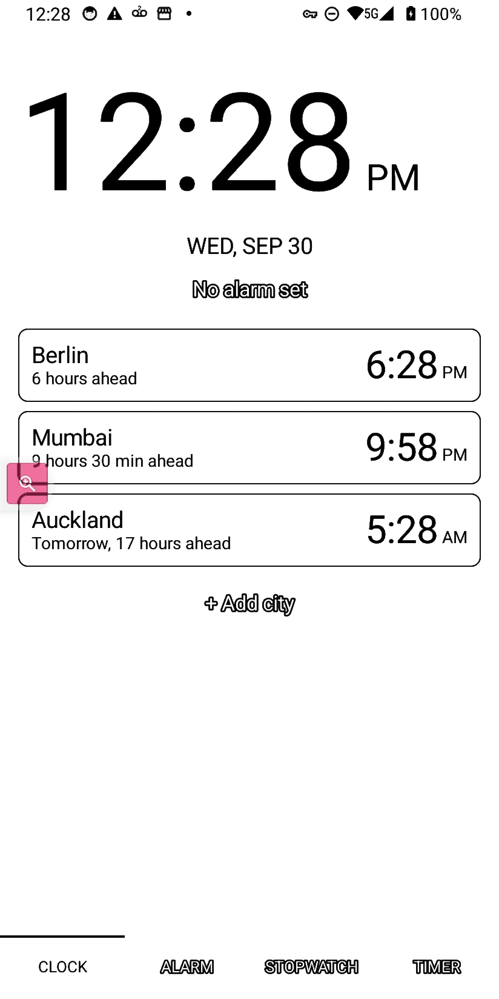
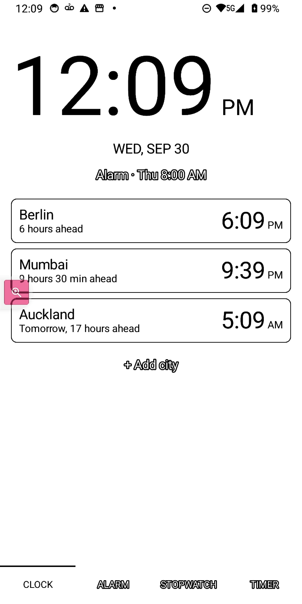
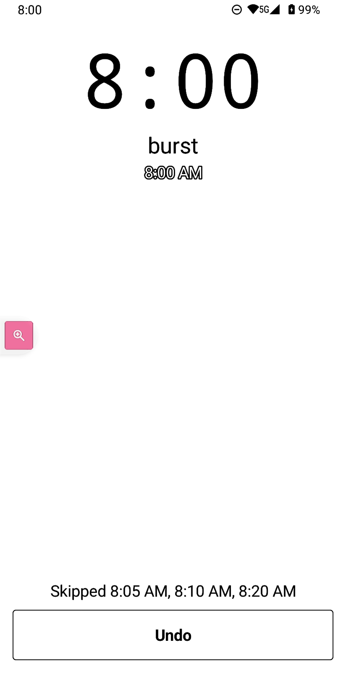

# Clock — a debloated, e-ink-first alarm app for the Bigme HiBreak Pro

A ~253 KB replacement for the 10.2 MB OEM alarm app, built for one specific phone:
an e-ink Android 14 device where every animation is a defect and every wasted
megabyte is a byte the panel does not have to repaint.

| | |
|---|---|
| Package | `com.ilyaas.einkclock` |
| Device | Bigme HiBreak (HiBreak Pro), Android 14 / SDK 34, arm64-v8a, e-ink 824×1648 @ 300 dpi |
| Stack | Kotlin, classic framework `Activity`/`View`s. **No AndroidX, no Compose, no coroutines, no third-party libraries** |
| APK | 253 KB, one `classes.dex`, **zero** native libraries, `resources.arsc` 7.5 KB, English only |
| Tests | 21 JVM unit tests (`./gradlew :app:testDebugUnitTest`) |



## Why I wanted this

I wake up to a *burst* of alarms, not one. 8:00, 8:05, 8:10, 8:20 — an alarm every
5, 10 or 15 minutes for an hour, because one alarm is easy to sleep through and the
next one is the one that actually gets me up. That works exactly once: the morning I
wake up on my own, or the first alarm does its job, I am still being shouted at by
every remaining alarm in the set, and dismissing them one screen at a time at 8:03
is the opposite of a good morning.

What I wanted was one button on the ringing screen: **I'm awake** — meaning *this
whole run of alarms is done, cancel the rest of them for today, and bring them back
tomorrow.* Not "snooze everything", not "skip one", not a per-alarm "delete after
use". The rest of the burst is not a reminder; it is the same wake-up.

No alarm app I could find does that. AOSP DeskClock, LineageOS, GrapheneOS and the
FOSS clocks all dismiss exactly one instance ([the survey in `clock-audit/`](clock-audit/foss-android-alarm-eink-research.md)).
Fossify Clock, the closest thing to a base, implements "skip" by clearing today's
weekday bit with an upstream `TODO` calling it a hack — which is wrong for a
single-weekday alarm. So the feature had to live in an app I controlled anyway.

Three more things pushed me to write my own rather than patch someone else's:

- **It is an e-ink phone.** The HiBreak Pro's panel is the slowest part of every
  interaction: anything that animates, ripples, slides or repaints once a second is
  a defect, and a clock that redraws 60 times a second to show the same minute is
  pure waste. The screen should change when the information changes and not one
  frame more.
- **The stock app is a brick I cannot fix.** 10.2 MB, 8.7 MB of dex at 94.5 % of the
  single-dex 64 K method-reference limit, 1.7 MB of native libraries for three ABIs
  the phone cannot run, ~85 locales and 3.7 MB of resource table, 58 MB of PSS — and
  it is platform-signed with `sharedUserId=android.uid.system` on a phone with no
  root, so it cannot be patched, re-signed or replaced. It can only be disabled.
- **The small things mattered too.** I wanted the world clocks the stock app shows,
  with the cities *I* pick instead of Berlin/Mumbai/Auckland forever, and an alarm
  editor that is not a maze of Save / Cancel / OK / Delete where nothing tells you
  which one commits your change.

So: my own app, ~1/40th the size, no animation, no AndroidX, no Compose, no
coroutines, no third-party libraries, and one feature at the centre of it that
nothing else has — a wake-up burst that goes away in one press, per day only, with
Undo if I was too quick.

## Why the stock app could not do it

`com.android.deskclock` is an OEM-forked AOSP DeskClock, platform-signed and
`sharedUserId="android.uid.system"`, sitting at 94.5 % of the single-dex 64 K
method-reference limit. Adding a feature would need multidex surgery *and* the
platform signing key, on a device with no root. And the batch dismiss does not exist
upstream at all: `dismiss()` deletes one instance and returns.

The one vendor hook it exposes, `com.android.provider.AlarmProvider`, is a dud —
`query`/`insert`/`update`/`delete` all return nothing and `call("start_service")`
only re-runs boot init. It cannot be used to read or cancel alarms. Android has no
public API for app A to enumerate or cancel app B's alarms, so "I'm awake" has to
live inside whichever app owns the alarm database.

Disabled, not modified:

```
adb shell pm disable-user --user 0 com.android.deskclock   # → new state: disabled-user
adb shell pm enable com.android.deskclock                  # revert
```

## What it does

Four text-only tabs — **CLOCK · ALARM · STOPWATCH · TIMER** — in pure black on
pure white, with no ripple, no elevation, no transition and no per-second repaint.



### The headline: "I'm awake"

Alarms are usually a *burst*: 8:00, 8:05, 8:10, 8:20 — the same wake-up, four
times. When you are already up, one press must silence the rest of the burst:

1. The ringing screen shows the current time, the alarm's label and scheduled
   time, the scheduled time again if snoozed, and three buttons:
   **I'm awake** (full width), **Pause** and **Cancel** (half width each).
   Back and volume keys never dismiss it.
2. **I'm awake** dismisses this instance and then walks the alarm set forward in
   a chain: starting at *now*, it takes the next enabled alarm within
   `window` minutes **of the previous one**, skips it, and repeats. A burst with
   5-, 10- or 15-minute gaps therefore disappears as one unit instead of stopping
   after the first window.
3. Skips are rows in `alarm_skip(alarm_id, date)` — never a mutated repeat mask and
   never `enabled = 0`. Tomorrow is normal by construction, one-shot victims are
   disabled instead, and a 10-second **Undo** deletes today's rows and reschedules.
4. The window is configurable: **5 / 10 / 15 minutes** (Settings).



Measured on the phone: the 8:00 alarm fired for real at `08:00:00.205`, the ring
screen was up in **+110 ms**, and pressing *I'm awake* produced
`Skipped 8:05 AM, 8:10 AM, 8:20 AM` with three `alarm_skip` rows for today, every
row still `enabled=1` with `repeat_mask=127`, and every registered trigger moved to
tomorrow. An 8:40 alarm — outside the chain — stayed armed. `dumpsys alarm` and the
raw database pull are in [TESTING.md](TESTING.md).

### Everything else

- **Alarm list** — one bordered card per alarm: `HH:MM` at 56 sp (24- or 12-hour
  per the system setting, dimmed to 50 % gray when off), label + repeat summary
  (`Every day`, `Weekdays`, `Mon, Tue, Wed`, `Once`, plus `skipped today`), and a
  framework `Switch` on the right. Tap to edit, long-press for Edit / Delete.
- **Editing without ambiguity** — `+` asks for the time first and creates the
  alarm; the detail screen writes **every change immediately** (time, label, days,
  snooze, vibrate, ringtone). There is no Save button to hunt for: only **Done** to
  leave and **Delete** (confirmed) to remove.
- **World clock** — bordered cards with city, `N hours ahead` /
  `Tomorrow, N hours ahead`, and the local time. Default selection matches the
  stock app (Berlin · Mumbai · Auckland), `+ Add city` picks from ~34 zones.
- **Stopwatch** — `MM:SS.hh` in mono, 10 Hz while running, 0 Hz while stopped,
  surviving process death.
- **Timers** — N simultaneous timers, presets `1m · 5m · 10m · 15m · 30m · 1h`,
  pause/resume, `+1 min`, a plain 4 dp progress bar, and a "Timers up" screen.
- **Intent API** — `SET_ALARM`, `SET_TIMER`, `SHOW_ALARMS`, `SHOW_TIMERS`,
  `DISMISS_ALARM`, `DISMISS_TIMER`, `SNOOZE_ALARM` (with the stock manifest's
  `com.android.alarm.permission.SET_ALARM` alias guard).
- **Scheduling** — `setAlarmClock()` per alarm (so SystemUI shows the next alarm and
  Doze leaves it alone), exact alarms for timers, `directBootAware` receiver and
  service, alarms and prefs in device-protected storage (`/data/user_de/0/…`), and
  re-registration on boot, locked boot, time set, timezone change and app update.

## Build and install

```bash
# build (JDK 17-21, Android SDK with platform 35)
./gradlew :app:assembleDebug
./gradlew :app:testDebugUnitTest

# install + make it the alarm app (non-interactive)
scripts/install.sh                       # adb install, grant notifications, disable the stock clock

# put the phone back
scripts/revert.sh                        # re-enable the stock clock, uninstall Clock
```

There is no `ALARM_CLOCK` role on this ROM, so making Clock the default is: disable
the stock app (the script does it) and pick Clock once in the `SET_ALARM` chooser.
Verify with:

```bash
adb shell cmd package resolve-activity --brief -a android.intent.action.SHOW_ALARMS
# com.ilyaas.einkclock/.api.HandleApiActivity
```

Two Android 14 permissions matter and are nudged on first run:

- **Display over other apps** (`SYSTEM_ALERT_WINDOW`) — without it, Android 14
  blocks a background app from raising the ring screen; the alarm would only post a
  notification while the phone is unlocked. `scripts/install.sh` grants it over adb;
  Settings shows the status and a deep link.
- **Battery optimization exemption** — otherwise Doze can delay alarms.

## What was measured, and where it misses

Full raw output is in [TESTING.md](TESTING.md). The honest summary:

| Gate | Target | Result |
|---|---|---|
| APK ≤ 600 KB | 600 KB | **253 KB** ✅ |
| One dex, no `.so`, en-only | yes | **yes** ✅ |
| Cold start ≤ 300 ms | 300 ms | median **304 ms** (287–324 in the final series) — faster than the stock app (median 376 ms) and Settings (461 ms), but only just at the line ❌/✅ |
| PSS ≤ 25 MB | 25 MB | 49–59 MB (stock: 58–65 MB) ❌ — the shared framework floor alone is ~38 MB on this ROM |
| 0 idle frames | 0 | 0 frames / 30 s, 0–1 / 60 s (one minute-boundary repaint, no seconds, nothing periodic) ✅ |
| T0–T8 acceptance | pass | pass, with two documented adaptations (see TESTING.md) |

## Layout

```
app/src/main/java/com/ilyaas/einkclock/
  data/       SQLite (device-protected), models, prefs, world-clock catalogue
  alarm/      next-trigger math, scheduler, receivers, ringing service, ring actions, timers
  ui/         MainActivity (tab shell), one view class per tab, ring/edit/settings screens
  api/        alarm clock intent API
  debug/      debug-only test hooks (test ring, alarm factory, DB dump) — never in release
app/src/test/ JVM unit tests for the scheduling math and the "I'm awake" selector
clock-audit/  the original audit this app was built from (measurements, stock APK, screenshots)
docs/         screenshots used by this README and TESTING.md
```
